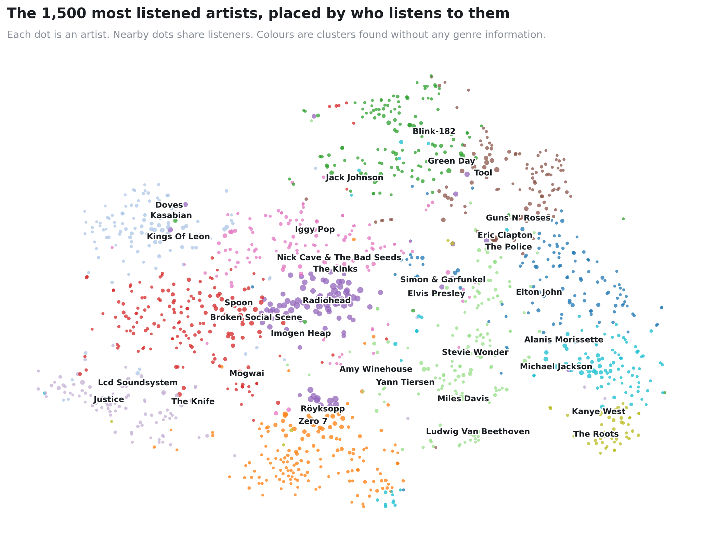
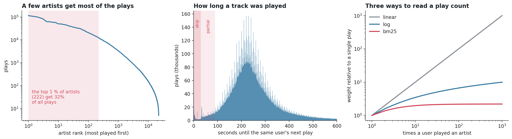
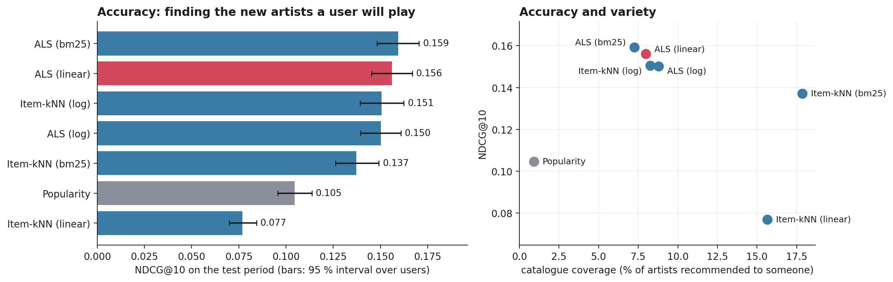
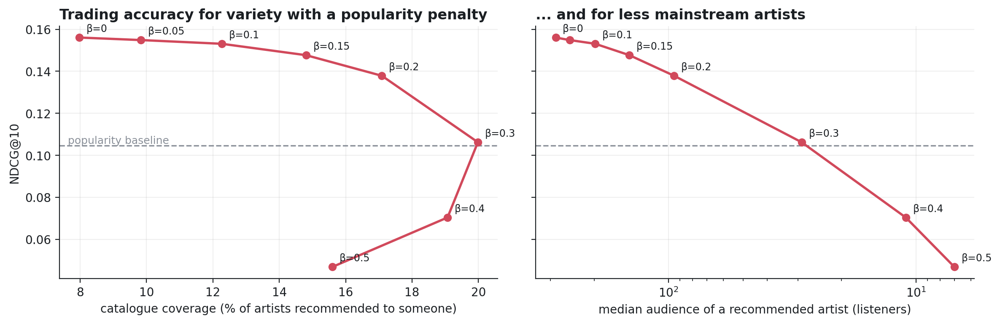

<h1 align="center">Music recommendation from listening history</h1>

<p align="center">
  <b>What should this person listen to next? Learning it from 19 million plays, with no ratings and no genre labels</b>
</p>

<p align="center">
  <a href="https://github.com/27pepablo/lastfm-music-recommender/actions/workflows/ci.yml"></a>
  
  
  
  <a href="LICENSE"></a>
</p>



<p align="center"><i>
The model was only told who played what. It placed metal next to metal, hip-hop next to hip-hop
and electronic next to electronic on its own: every dot is an artist, and artists end up close
together when the same people listen to them.
</i></p>

## At a glance

| | |
|---|---|
| **Task** | Recommend ten artists a listener has not played yet and will go on to play |
| **Data** | [Last.fm 1K](http://ocelma.net/MusicRecommendationDataset/lastfm-1K.html): 19.2 million timestamped plays by 992 users |
| **Signal** | Implicit feedback only. Skipped tracks are detected from the time between plays |
| **Model** | Matrix factorisation by alternating least squares (Hu, Koren & Volinsky), **implemented from scratch** with a vectorised conjugate-gradient solver |
| **Baselines** | Most-popular chart · item-based nearest neighbours |
| **Evaluation** | Split by time (train on the past, test on the future) · hyperparameters chosen on a separate validation period · bootstrap confidence intervals |
| **Result** | **+49 % NDCG@10** over the popularity chart (0.156 vs 0.105), **65 %** of users get at least one hit in ten, and **9×** more of the catalogue is recommended |
| **Stack** | Python · NumPy · SciPy (sparse) · pandas · PyArrow · scikit-learn · Matplotlib · pytest · GitHub Actions |

## Contents

- [Try it in ten seconds](#try-it-in-ten-seconds)
- [The problem](#the-problem)
- [The data](#the-data)
- [Method](#method)
- [Results](#results)
- [What the model learned](#what-the-model-learned)
- [Reproduce everything](#reproduce-everything)
- [Repository layout](#repository-layout)
- [Limitations](#limitations)
- [About this project](#about-this-project)
- [References and license](#references-and-license)

## Try it in ten seconds

The vectors of the 5 000 most listened artists ship with the repository, so the trained
model can be queried without downloading any data:

```bash
git clone https://github.com/27pepablo/lastfm-music-recommender.git
cd lastfm-music-recommender
pip install -e .
python scripts/similar_artists.py "Daft Punk"
```

```
Daft Punk  (538 of 960 listeners)

   listeners who play this also play    listeners     lesser-known, same taste   listeners
1              The Chemical Brothers          473                      Alcazar          40
2                           Gorillaz          522                   Anne Clark          37
3                               Moby          497                       Ugress          39
4                                Air          550                   Angel City          35
5                          Radiohead          706                      Cerrone          39
6                     Massive Attack          536                     Carl Cox          39
7                           Coldplay          634             Sander Van Doorn          32
8                           Röyksopp          447                       Cicada          37
```

## The problem

Streaming services do not know what you like. They know what you *played*. That is a
different kind of evidence from a star rating:

- **Nobody says "I dislike this".** An artist you never played might be one you would
  hate, or one you would love and have not found yet.
- **Counts are not opinions.** 500 plays is not 250 times more love than 2 plays.
- **Not every play is a listen.** A track skipped after ten seconds is still logged.
- **A few artists get most of the attention.** Recommending them to everybody is
  accurate on average and useless as a product.

This project builds a recommender that deals with all four, and measures it the way it
would be used: train on what each person played in the past, recommend artists they
have never played, and check against what they actually played afterwards.

## The data



| | |
|---|---|
| Plays in the raw log | 19 150 868 |
| Users / artists after cleaning | 960 / 22 217 |
| Distinct user-artist pairs | 665 818 (2.7 % of the matrix is filled) |
| Plays skipped within 30 s / partially heard | 0.8 % / 2.7 % |
| Typical time between two plays | 4 minutes |
| Plays going to the top 1 % of artists | 32 % |

**Left:** popularity is extremely uneven. **Centre:** the log has no "skipped" flag, but
it has timestamps; the time until a user's next play peaks at the length of a song, with
a separate bump of plays abandoned within seconds. Plays followed by another one in
under 30 s count as skips (weight 0), 30 to 90 s as partial listens (weight 0.5 to 0.8).
**Right:** three ways to turn a play count into a weight, compared below.

## Method

```
 raw log                 clean                    split by time                 learn                  recommend
19 M plays   ──►  skip weights          ──►   first 70 %  fit          ──►   popularity         ──►  top 10 artists
(user, time,      merge duplicate artists      next 10 %  validation         item-kNN                the user has
 artist)          drop rare users/artists      last 20 %  test               implicit ALS            never played
```

1. **Clean** ([`prepare.py`](src/musicrec/prepare.py)). Weight every play by how long it
   was heard, merge artists that appear under several spellings or identifiers, drop
   artists with fewer than 5 listeners and users with fewer than 50 artists.
2. **Split by time.** Each user's history is cut in time order into 70 % / 10 % / 20 %.
   Models are tuned on the middle part and reported on the last one, which is used once.
3. **Weight** ([`weighting.py`](src/musicrec/weighting.py)). Play counts are turned into
   confidence with a linear, logarithmic or BM25 transformation.
4. **Learn** ([`models.py`](src/musicrec/models.py)). Implicit ALS gives every user and
   every artist a vector such that their dot product is high when the user plays the
   artist. It treats "never played" as weak evidence of "not interested" rather than
   ignoring it, which is what makes it work without negative feedback.
5. **Recommend and score** ([`evaluation.py`](src/musicrec/evaluation.py)). The ten
   highest-scoring artists the user has not played. A hit is an artist the user plays
   for the first time in the test period.

The ALS solver is written from scratch in NumPy. All the per-user linear systems are
solved together with a few conjugate-gradient steps expressed as sparse matrix products,
so there is no Python loop over users or artists and one pass over 570 000 observed
pairs takes about a second. The test suite checks it against a direct dense solution.

A longer explanation, with the equations and the reasons for each choice, is in
**[docs/how_it_works.md](docs/how_it_works.md)**.

## Results

All numbers are on the test period: 960 users, 92 394 first-time artists to find (a
median of 56 per user) among 22 217 candidates. Produced by
[`scripts/03_evaluate.py`](scripts/03_evaluate.py), stored in
[results/metrics.json](results/metrics.json).



<p align="center"><i>
Red: the configuration chosen on validation data before looking at the test period, which is
the one reported as "the model" throughout. Grey: the non-personalised baseline.
</i></p>

| Model | Precision@10 | NDCG@10 (95 % interval) | Users with a hit | Catalogue coverage |
|---|---:|---:|---:|---:|
| Random | 0.5 % | 0.005 | 4 % | 35 % |
| Popularity chart | 9.8 % | 0.105 (0.096 – 0.114) | 50 % | 0.9 % |
| Item-kNN, log weights | 14.3 % | 0.151 (0.139 – 0.162) | 63 % | 8.3 % |
| **Implicit ALS** (selected on validation) | **14.9 %** | **0.156** (0.145 – 0.167) | **65 %** | 8.0 % |

Reading the table: with ALS, 1.5 of every 10 recommended artists are ones the user
went on to discover by themselves, and two users in three get at least one such hit.
The chart of most popular artists manages 1 in 10 and recommends the same 200 artists
(0.9 % of the catalogue) to everyone.

### Four findings

**1. Personalisation is worth 49 % over the popularity chart.**
Comparing the two on the same users, ALS is ahead by 0.052 NDCG@10 (95 % interval 0.042 to
0.062), and it was ahead in every one of 5 000 bootstrap resamples. It also draws its
recommendations from nine times more artists.

**2. A simple neighbour model is almost as good.** Item-kNN reaches 0.151 against 0.156
for ALS. The paired difference is 0.006 with a 95 % interval of
-0.003 to 0.015, which includes zero. On a dataset with under a thousand users, matrix factorisation has
no decisive edge in accuracy. What it adds is a compact vector per artist, which is
what the map, the similar-artist search and the hidden gems below are built on.

**3. Once tuned, the way play counts are weighted barely matters for ALS.**

| ALS weighting | Best setting found on validation | NDCG@10 on test |
|---|---|---:|
| linear | 128 factors, λ = 38.9, α = 0.42 | 0.156 |
| log | 64 factors, λ = 60.5, α = 3.9 | 0.150 |
| BM25 | 32 factors, λ = 61.3, α = 0.44 | 0.159 |

The three overlap within their confidence intervals. The original notebook, which
used one hand-picked setting for all three (α = 40, λ = 0.01), found a threefold gap in
favour of BM25 and linear weighting below the popularity chart. That gap came from the
hyperparameters and not from the weighting: a large α lets a few heavy listeners
dominate, and each weighting needs its own α and a much stronger λ to prevent it. For the neighbour model, which has no such parameter, the weighting does matter
(linear 0.077, log 0.151).

**4. Down-weighting skipped plays made no measurable difference.** Training on
skip-weighted counts gives NDCG@10 = 0.1534 and on raw counts 0.1538 (means of five
random initialisations, whose own spread is ±0.002). Skips are 0.8 % of plays and are
spread thinly, so at the level of "does this user listen to this artist" they change
almost nothing. The idea is sound; this dataset simply has too few skips for it to matter,
and it would be worth revisiting for track-level recommendation.

### Accuracy against variety



Dividing each score by `listeners ** β` pushes recommendations away from the most
popular artists. A small penalty is nearly free: at **β = 0.1** the share of the
catalogue being recommended grows from 8.0 % to 12.3 % and the typical recommended
artist has 198 listeners instead of 286, while NDCG@10 goes from 0.156 to 0.153 and the
share of users with a hit rises slightly (65 % to 66 %). Beyond β = 0.2 accuracy falls
quickly, and at β = 0.3 the model is no better than the popularity chart.

## What the model learned

No genre, tag or audio feature was used. Everything below comes from the artist
vectors, that is, from co-listening alone.

**Nearest neighbours**

| Miles Davis | Metallica | Jay-Z | Johnny Cash | Daft Punk |
|---|---|---|---|---|
| John Coltrane | Red Hot Chili Peppers | Outkast | Bob Dylan | The Chemical Brothers |
| Herbie Hancock | Guns N' Roses | Kanye West | The Rolling Stones | Gorillaz |
| Charlie Parker | The Offspring | Nas | David Bowie | Moby |
| Ella Fitzgerald | Korn | The Game | The Beatles | Air |
| Duke Ellington | System Of A Down | Eminem | The Clash | Massive Attack |
| Brian Eno | Pantera | Dr. Dre | Pink Floyd | Röyksopp |

**Hidden gems**: the closest artists with only 8 to 25 listeners (number in brackets)

| Miles Davis | Metallica | Jay-Z | Johnny Cash |
|---|---|---|---|
| Clifford Brown (24) | Exilia (12) | Joe Budden (24) | Bob Dylan & Johnny Cash (21) |
| Dave Douglas (16) | S.O.D. (25) | Akala (18) | The Peacocks (12) |
| John Abercrombie (10) | Vision Divine (12) | Underground Kingz (25) | June Carter Cash (13) |
| Jon Hassell (17) | Sabaton (21) | Youngbloodz (25) | The Highwaymen (21) |
| Chicago Underground Trio (10) | Nailbomb (14) | Slim Thug (23) | The Charlie Daniels Band (13) |
| Michel Camilo (11) | Kataklysm (24) | Yung Joc (23) | Wolfe Tones (8) |

**One listener.** Their ten most played artists in the training period, and what each
system would have suggested. ✔ marks artists they went on to play for the first time.

| Most played so far | Popularity chart | Model (ALS) |
|---|---|---|
| Air | The Clash | Belle And Sebastian ✔ |
| Metric | Belle And Sebastian ✔ | David Gray ✔ |
| Röyksopp | Bob Dylan ✔ | Snow Patrol ✔ |
| Moby | The Who | The Velvet Underground |
| Boards Of Canada | Snow Patrol ✔ | The Flaming Lips |
| Massive Attack | The Velvet Underground | Cocorosie ✔ |
| Goldfrapp | Joy Division | Simon & Garfunkel ✔ |
| Thievery Corporation | The Flaming Lips | Jimi Hendrix |
| Fischerspooner | [Unknown] | Bob Dylan ✔ |
| Télépopmusik | Jimi Hendrix | Black Rebel Motorcycle Club |

More examples, including listeners for whom the model does less well, are in
[results/examples.md](results/examples.md).

## Reproduce everything

```bash
pip install -e ".[dev]"
pytest                                          # 26 tests, a few seconds, no data needed

python scripts/01_prepare_data.py --download    # ~640 MB download, then about 1 minute
python scripts/02_tune.py                       # hyperparameter search on validation, ~25 minutes
python scripts/03_evaluate.py                   # final numbers on the test period, ~15 minutes
python scripts/04_figures.py                    # figures and example tables
```

Everything runs on a laptop CPU with 8 GB of RAM. To see the whole pipeline work in
under a minute without the download, run it on synthetic listeners with hidden taste
groups (this is what the CI does):

```bash
python scripts/00_make_synthetic_data.py --out demo/data
python scripts/02_tune.py     --data demo/data --out demo/results/tuning.csv --trials 3
python scripts/03_evaluate.py --data demo/data --results demo/results --seeds 1
python scripts/04_figures.py  --data demo/data --results demo/results --out demo/figures
```

Using the library directly:

```python
from musicrec import dataset, weighting, evaluation
from musicrec.models import ImplicitALS

data = dataset.load()  # data/processed, written by scripts/01_prepare_data.py
split = data.split("test")  # train on the past, relevant = first-time artists in the future

model = ImplicitALS(factors=128, regularization=38.9, alpha=0.42).fit(weighting.linear(split.train))
top10 = evaluation.top_k(model.scores(), seen=split.train, k=10)
print(evaluation.evaluate(top10, split.relevant, split.listeners).summary())
```

## Repository layout

```
src/musicrec/
  prepare.py       raw log -> skip weights, artist merging, time split, filters
  weighting.py     linear, log and BM25 confidence
  models.py        ImplicitALS (from scratch), ItemKNN, Popularity
  evaluation.py    top-k, precision / recall / NDCG / hit rate / coverage, bootstrap, popularity penalty
  explore.py       similar artists, hidden gems
  dataset.py       sparse matrices and train / validation / test splits
  synthetic.py     synthetic listening logs with known structure
scripts/
  00_make_synthetic_data.py   01_prepare_data.py   02_tune.py   03_evaluate.py   04_figures.py
  similar_artists.py          query the shipped model from the command line
tests/             26 tests: hand-computed metrics, ALS against a direct solver, loss against brute force
docs/
  how_it_works.md  the method in detail
  figures/
results/
  tuning.csv  metrics.json  examples.md  artist_vectors.npz
```

## Limitations

- **Small user base.** 960 users is tiny next to a real service. The confidence
  intervals are wide and the ranking between ALS and item-kNN could change with more data.
- **Old data.** The log ends in 2009, which is why the map has no artist from the last
  fifteen years.
- **Offline evaluation.** A recommendation only counts if the user found that artist
  on their own. A good suggestion they never came across is scored as a miss, so the
  absolute numbers understate usefulness; comparisons between models are still fair.
- **Skips are inferred.** Without track durations, a long track abandoned halfway is
  indistinguishable from a short one played in full.
- **Artist identity.** Duplicates and mis-tagged names remain in the long tail and
  sometimes surface among the hidden gems.

## About this project

This began as a mini-project for *Large Scale Media Analysis* (MSc in Signal Theory and
Communications, Universidad Politécnica de Madrid, 2026): a Colab notebook built on the
`implicit` library. This repository is my rewrite of it as a tested package. What changed:

- **The model is implemented from scratch** instead of imported, including the
  conjugate-gradient solver.
- **The evaluation was fixed.** In the notebook two thirds of the "correct answers" were
  artists the user already knew, which the recommender was not allowed to suggest, so
  every score was deflated. Hits are now first-time artists only.
- **Hyperparameters are tuned on a validation period** instead of fixed by hand, which
  overturned the notebook's main conclusion (finding 3 above).
- **Honest baselines and error bars**: item-kNN, bootstrap intervals, paired
  comparisons, several random initialisations.
- **The skip heuristic was tested** instead of assumed to help (finding 4).
- Duplicate artists are merged, the time gaps are measured before filtering, and the
  whole pipeline runs from the command line with a CI check.

## References and license

- Y. Hu, Y. Koren, C. Volinsky. *Collaborative Filtering for Implicit Feedback Datasets.* ICDM 2008.
- G. Takács, I. Pilászy, D. Tikk. *Applications of the Conjugate Gradient Method for Implicit Feedback Collaborative Filtering.* RecSys 2011.
- S. Robertson, H. Zaragoza. *The Probabilistic Relevance Framework: BM25 and Beyond.* 2009.
- Ò. Celma. *Music Recommendation and Discovery in the Long Tail.* Springer, 2010.

Code released under the [MIT License](LICENSE). The Last.fm 1K dataset is distributed by
its author with permission of Last.fm for non-commercial use; it is not included here and
is downloaded from its original source. `results/artist_vectors.npz` contains model
parameters and artist names only.
